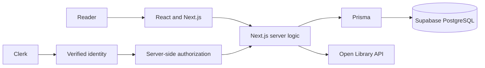

# Folio

**Your books. Your reading journey.**

Folio is a personal reading library built for a university Computer Science research milestone. It lets a reader discover real books through Open Library, sign in with Clerk, save books to a private collection, organize them by reading status, and keep a one-to-five-star rating and personal notes. The project demonstrates one complete TypeScript web stack while keeping the product small enough to understand end to end.


## How it works

1. A visitor learns what Folio offers and signs in or creates an account.
2. The signed-in discovery page narrows its current shelf immediately as the reader types, then refreshes it from Open Library after a short pause. It includes a live count, highlighted title suggestions, typo tolerance, and closest-title guidance.
3. A submitted query is validated by Folio's server and sent to Open Library. Folio normalizes the response before it reaches React.
4. A reader opens a result and saves it. The server obtains the owner ID from the verified Clerk session.
5. The private library stores the book independently of Open Library. Status, rating, and notes persist in Supabase PostgreSQL.
6. Every read, edit, and removal is scoped to the authenticated owner.

The application provides accessible loading, empty, error, and not-found states and responsive layouts for phone and desktop widths.

## Technology stack

| Technology | Use in Folio |
| --- | --- |
| Next.js 16 App Router | Pages, layouts, Server Components, Route Handlers, metadata, and production build |
| React 19 | Interactive search, dialogs, filters, and library editing |
| TypeScript | Static checks for components, server logic, API data, and tests |
| Standard CSS | The responsive ivory, forest, charcoal, sage, and gold visual system |
| Node.js 24 | Local tooling and the server runtime used by Next.js |
| Clerk | Sign-up, sign-in, account controls, verified sessions, and private-route protection |
| Prisma 7 | Typed queries, the PostgreSQL model, and version-controlled migrations |
| Supabase PostgreSQL | Persistent saved books, status, ratings, and notes |
| Open Library | Live book search metadata and cover images |
| npm | Locked dependency installation and project scripts |
| Vercel | Prepared hosting target for the Next.js application |

## Architecture



The browser never supplies a trusted owner ID. A library Route Handler verifies the Clerk session, validates unknown request data, and includes the resulting `userId` in each Prisma operation. Saved metadata lives in PostgreSQL, so an existing library does not depend on Open Library being available.

Open Library requests use a fixed upstream host, selected fields, a timeout, normalized results, a one-hour Next.js cache, and conservative request spacing. The UI protects fast typing from stale responses with request cancellation and request identity checks.

## Data model

`SavedBook` contains:

- a UUID primary key;
- the Clerk owner ID and stable Open Library work key;
- title, author, optional cover ID, and optional first-publication year;
- one of `WANT_TO_READ`, `READING`, or `FINISHED`;
- an optional integer rating from 1 to 5 and optional notes;
- created and updated timestamps.

The pair `(clerkUserId, openLibraryKey)` is unique, so one reader cannot save the same work twice. A database check constraint enforces the rating range. The owner/status index supports private shelf filtering. Row-level security is enabled with no public policies; Prisma is the trusted server connection, and application queries still enforce Clerk ownership.

## Project structure

```text
prisma/                  schema and committed SQL migrations
scripts/                 database and deployment preflight checks
src/app/                 pages, Route Handlers, shared layout, and error states
src/components/          search, book details, auth, and library interfaces
src/lib/                 validation, Open Library, auth, Prisma, and data access
tests/                   Node test-runner coverage for server and pure logic
docs/DEPLOYMENT.md       Vercel setup and production validation
docs/DEMO.md             demonstration checklist and submission issue draft
```

## Local setup

### Prerequisites

- Git
- Node.js **24 LTS** and npm; `.nvmrc` and `package.json` both identify the expected runtime
- a Clerk development application
- a Supabase PostgreSQL project

Clone and install the exact locked dependency tree:

```bash
git clone https://github.com/aryananand0/Folio.git
cd Folio
npm ci
cp .env.example .env.local
```

Fill `.env.local` with your own values. Never commit this file.

| Variable | Purpose |
| --- | --- |
| `NEXT_PUBLIC_CLERK_PUBLISHABLE_KEY` | Clerk's browser-visible publishable key |
| `CLERK_SECRET_KEY` | Clerk's server-only secret key |
| `DATABASE_URL` | Supabase transaction pooler on port 6543 for application queries |
| `DIRECT_URL` | Supabase session/direct connection on port 5432 for Prisma migrations |
| `OPEN_LIBRARY_CONTACT_EMAIL` | Optional contact in the server-side Open Library User-Agent |

Apply the committed schema and verify connectivity:

```bash
npm run deploy:check
npm run db:deploy
npm run db:status
npm run db:check
```

Start the application and open [http://localhost:3000](http://localhost:3000):

```bash
npm run dev
```

Use `localhost`, rather than the numeric loopback address, for the local Clerk flow.

## Commands

| Command | Purpose |
| --- | --- |
| `npm ci` | Recreate the exact dependency tree from `package-lock.json` |
| `npm run dev` | Start the Next.js development server |
| `npm test` | Run the lightweight Node test suite |
| `npm run lint` | Run ESLint across the repository |
| `npm run typecheck` | Generate route types and run TypeScript without emitting files |
| `npm run build` | Create the production Next.js build |
| `npm run start` | Serve an existing production build |
| `npm run db:generate` | Regenerate Prisma Client from the schema |
| `npm run db:migrate -- --name change_name` | Create and apply a development migration |
| `npm run db:deploy` | Apply committed migrations without creating new ones |
| `npm run db:check-library` | Exercise duplicate, filter, ownership, update, and cleanup behavior |
| `npm run deploy:check` | Validate deployment variable structure without printing secrets |

## API surface

| Method and route | Behavior |
| --- | --- |
| `GET /api/books/search?q=...` | Validates a query, calls Open Library, and returns normalized books |
| `POST /api/library` | Saves a book once for the authenticated reader |
| `PATCH /api/library/:id` | Updates that reader's status, rating, or notes |
| `DELETE /api/library/:id` | Removes that reader's saved book |

Library endpoints return `401` without a session. Updates and deletes include both the record UUID and verified owner ID, so knowing another record's ID is insufficient to modify it.

## Technology research and comparisons

These comparisons reflect Folio's scope. Each alternative can be a sound choice under different constraints.

| Comparison | Advantages and limitations | Why Folio uses the selected option |
| --- | --- | --- |
| **Next.js vs Vite + React** | Next.js combines routing, server rendering, Route Handlers, and deployment conventions, but adds server/client boundaries and framework conventions. Vite gives a smaller client-focused setup and flexible backend choices, but Folio would need a separate API and routing design. | Next.js keeps the interface and authenticated server logic in one repository and one Vercel deployment. |
| **React vs Vue** | React has a broad ecosystem and fits Next.js directly, while requiring deliberate state and effect design. Vue offers approachable templates and integrated reactivity, but would replace the required Next.js/React stack. | React is the rendering model supported by the selected full-stack framework and Clerk components. |
| **Node.js vs a separate Python backend** | Node lets client and server share TypeScript types and one build. CPU-heavy work is not its focus. Python has excellent data tooling, but a separate service would add another runtime, deployment, API boundary, and dependency system. | Folio's work is I/O-heavy and modest, so Next.js Route Handlers on Node are sufficient. |
| **Clerk vs Supabase Auth** | Clerk provides hosted account UI and current Next.js helpers, with an external service dependency and production-domain configuration. Supabase Auth can consolidate services, but was outside the required architecture and would couple identity to the database provider. | Clerk satisfies the course stack and supplies a server-verifiable identity without custom password code. |
| **PostgreSQL vs MongoDB** | PostgreSQL supplies constraints, transactions, enums, indexes, and relational querying; schema changes require migrations. MongoDB offers flexible documents and can suit rapidly varying records, but application code must still protect consistency. | A saved book has stable structured fields, uniqueness, and rating rules that map clearly to PostgreSQL. |
| **Prisma vs raw SQL** | Prisma generates typed queries and reviewable migrations, but adds generated code, a driver adapter, and ORM-specific concepts. Raw SQL exposes full database behavior and can be leaner, but requires manual result typing and more repetitive query handling. | Prisma reduces type drift across TypeScript and PostgreSQL while leaving SQL migrations inspectable. |
| **Vercel vs Render** | Vercel provides first-class Next.js builds, previews, and serverless functions, with platform limits and serverless connection concerns. Render is flexible for long-running services, but a persistent server is unnecessary here. | Folio is one Next.js app, so Vercel offers the shortest supported deployment path. |
| **npm vs pnpm** | npm ships with Node and has a familiar lockfile and broad compatibility, though `node_modules` can use more disk space. pnpm is efficient and strict about dependency access, but adds another package-manager requirement. | npm is required by the milestone and `npm ci` gives reproducible installs from the committed lockfile. |

## npm findings

`package.json` lists Folio's direct dependencies, scripts, project metadata, and Node expectation. `package-lock.json` records exact resolved versions, integrity hashes, and transitive dependencies, so it is committed and `npm ci` can reproduce the same tree. `node_modules/` contains generated, platform-local package files and is ignored.

`npm install` resolves dependencies and updates the lockfile when the manifest changes. `npm ci` removes the existing installed tree and accepts only a lockfile that agrees with the manifest, which makes it appropriate for clean clones and CI. `npm uninstall <package>` removes a direct dependency and updates both package files. `npm run <name>` executes a named script with local package executables on its path.

A direct dependency is explicitly listed by Folio; a transitive dependency is required by one of those packages. Exact versions pin direct packages deliberately, while the lockfile pins the complete resolved graph. When compatibility fails, inspect the actual error, Node/npm versions, `npm ls`, package `engines`, and `peerDependencies`; compare official release documentation; then make the smallest compatible version change and rerun the complete checks. Folio does not hide peer conflicts with `--force` or `--legacy-peer-deps`.

## Research findings and resolved challenges

- **Server verification is the authorization boundary.** Hiding controls in React cannot protect data. Every private operation obtains Clerk's session on the server and scopes its query to that identity.
- **Next.js 16 uses `proxy.ts`.** The installed documentation confirmed the current convention; older tutorials referring only to `middleware.ts` were not copied blindly.
- **Server and Client Components have distinct jobs.** Library reads remain server-side, while browser state is limited to interactions such as filtering, dialogs, optimistic controls, and editing.
- **External JSON is untrusted.** Open Library fields are narrowed and normalized before rendering. A fixed URL builder, timeout, caching, restrained fields, and clear failures keep the integration bounded.
- **Fast search needs ordering guarantees.** Debouncing alone does not prevent an older response from replacing a newer query. Folio aborts obsolete requests and checks the active request before updating state.
- **Prisma 7 requires explicit connection design.** The application uses `@prisma/adapter-pg`; migrations use `DIRECT_URL`, while runtime traffic uses the transaction pooler in `DATABASE_URL`. Prisma Client is regenerated during `postinstall` for Vercel.
- **RLS does not replace application authorization here.** RLS is enabled without public policies. The trusted Prisma server connection performs owner-scoped queries using the verified Clerk ID.
- **Clerk development hosts must agree.** Using `localhost` consistently fixed a development handshake that redirected away from a server bound only to `127.0.0.1`.
- **Generated route types are shared build artifacts.** Type generation and production builds are run sequentially so concurrent writes under `.next` cannot create misleading duplicate declarations.

Free tiers also shape the design. Open Library asks clients to identify regular usage and respect its rate policy. Serverless instances cannot provide one global in-memory rate limit. Supabase has connection limits, so Vercel traffic uses its transaction pooler. Clerk development instances are suitable for a course demo; a true production instance requires the deployed custom domain and live keys. Vercel applies changed environment variables only to new deployments.

## Testing

The automated suite covers search input and normalization, Open Library failures and timeouts, typo matching and suggestions, auth configuration, saved-book validation, duplicate behavior, status/filter parsing, UUIDs, ratings, and notes. Live database checks create reserved temporary records and clean them up in `finally` while testing duplicate handling, owner isolation, filters, updates, and deletion.

The completed local verification includes:

- real Open Library searches, missing-field fallbacks, no-result handling, and detail-dialog keyboard behavior;
- real Clerk sign-up/sign-in, signed-out library redirect, account controls, and sign-out;
- Supabase migrations, connectivity, row-level-security status, persistence operations, and owner isolation;
- desktop and 390-pixel responsive review;
- ESLint, TypeScript, automated tests, and a production build.

Deployment is prepared but is not claimed as successful until the public URL passes the checklist in [docs/DEPLOYMENT.md](docs/DEPLOYMENT.md).

The current full npm audit reports nine high-severity entries across transitive Prisma CLI and Next.js ESLint dependency chains; four Prisma-chain entries are still reported with `--omit=dev`. They include tooling that Folio does not invoke in a request path and a MySQL driver Folio does not use, but the audit is not clean. npm proposes breaking downgrades of Prisma and the Next.js lint configuration, so those changes were not applied without upstream-compatible fixes. Recheck the advisories during dependency upgrades.

## Deployment

Folio needs no custom `vercel.json`. The repository declares Node 24, runs `prisma generate` in `postinstall`, uses a serverless-safe database pooler, and includes a secret-safe preflight command. Follow [the Vercel deployment guide](docs/DEPLOYMENT.md) to apply migrations, import the GitHub repository, add environment variables, select the correct Clerk mode, deploy, and verify the public application.

No public URL is listed yet because the hosted application has not been validated.

## Demonstration and submission

[docs/DEMO.md](docs/DEMO.md) contains a concise recording sequence and a ready-to-fill GitHub Issue body. The issue is intentionally not created by this repository work because the course instructions require the owner to add the final repository URL, video link, course mentions, and submit it explicitly.

## AI usage

OpenAI Codex assisted with documentation research, implementation drafts, code review, test execution, and troubleshooting. The repository owner controls commits, service configuration, deployment, and submission, and is responsible for reviewing and understanding the code. This statement should be adjusted if the course requires a specific disclosure format.

## References

- [Next.js documentation](https://nextjs.org/docs)
- [Clerk Next.js documentation](https://clerk.com/docs/reference/nextjs/overview)
- [Prisma ORM documentation](https://www.prisma.io/docs/orm)
- [Supabase: Prisma](https://supabase.com/docs/guides/database/prisma)
- [Open Library Search API](https://openlibrary.org/dev/docs/api/search)
- [Open Library API usage guidelines](https://openlibrary.org/developers/api)
- [Vercel: Next.js](https://vercel.com/docs/frameworks/full-stack/nextjs)

The organization of this README was informed by the research format in the team's [PlayState milestone repository](https://github.com/maximusf/PlayState); Folio's content, findings, architecture, and verification record describe this project.
